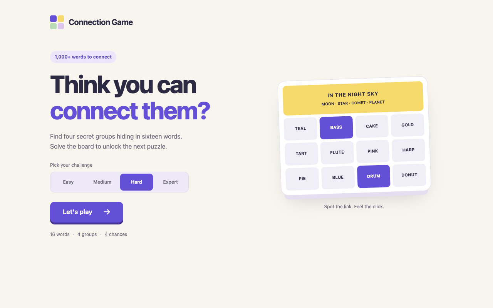
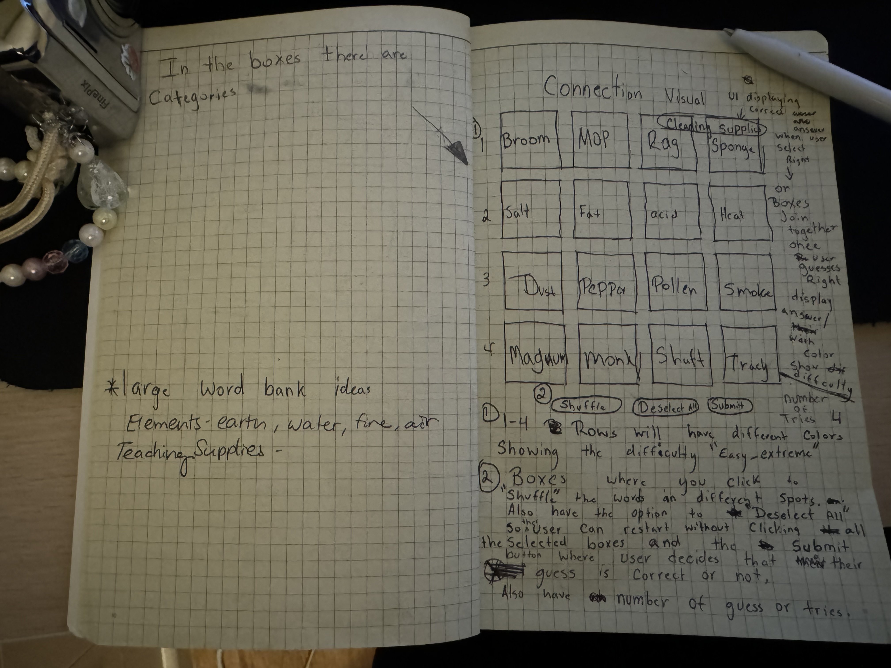
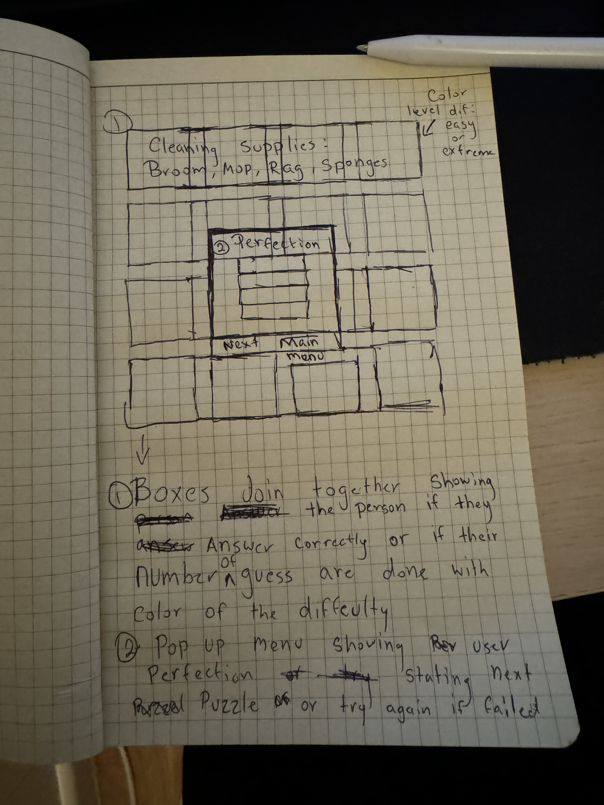
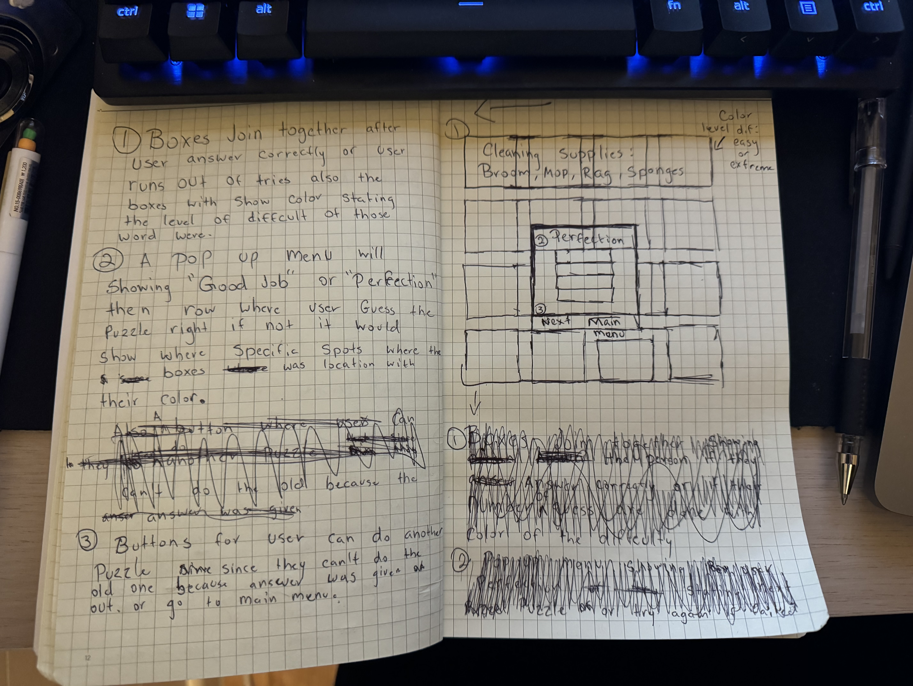

# Connection Game

Find four hidden connections among sixteen words. Start with everyday categories or take on wordplay, double meanings, and spelling tricks in the harder levels.

[Play online](https://spookyreaper.github.io/Connections-Game-/)

## Homepage



## How to play

1. Choose **Easy**, **Medium**, **Hard**, or **Expert**. Hard is selected by default.
2. Click **Let's play** to get a random puzzle at that level. Play avoids the last puzzle you played at the same level.
3. Select four words that share a connection, then click **Submit**.
4. Find all four groups before making four mistakes.

Correct guesses reveal a colored category banner. Wordplay groups also explain how the words connect. Incorrect guesses use one mistake and automatically deselect the tiles so you can try a new group. A **One away!** hint appears when three selected words belong to the same group.

Use **Shuffle** to rearrange the remaining words or **Deselect All** to clear your selection. Each solved group earns 10–40 points, for a maximum of 100 per puzzle.

After a win, **Next Puzzle** loads another board at the same level and resets your score and mistakes. After a loss, **Try Again** restarts that board. **Main Menu** lets you change difficulty or start another random puzzle.

## Difficulty levels

The collection contains **89 puzzles and 1,285 distinct words**. Each board contains 16 different words, arranged into four groups.

| Level | Puzzles | Connections |
| --- | ---: | --- |
| Easy | 65 | Familiar categories and straightforward meanings |
| Medium | 8 | Multiple meanings, shared phrases, and introductory wordplay |
| Hard | 8 | Indirect phrase connections and misleading associations |
| Expert | 8 | Hidden letter patterns, sound-alikes, and overlapping meanings |

Group colors show the relative difficulty of the four connections within a board.

## Features

- Random starting boards without immediately repeating the last puzzle at that level.
- Saved difficulty and a separate last-played puzzle for each level, when browser storage is available.
- Explanations for wordplay connections after solving or revealing a group.
- Phone and tablet layouts for portrait and landscape, with touch-sized controls.
- Keyboard-accessible tiles and difficulty controls, visible focus indicators, and reduced-motion support.
- Help and results dialogs that close with the close button, Escape, or a click outside the dialog.
- No timer, accounts, external fonts, or runtime dependencies.

## Run locally

1. Clone or download this repository.
2. Open `index.html` in a modern web browser.
3. Choose a difficulty and play.

No installation, build step, or development server is required. The game uses HTML, CSS, and plain JavaScript.

## Validate the puzzles

With Node.js installed, run:

```sh
node --test tests/puzzles.test.js
```

The checks validate the word count, distinct boards, complete four-word groups, valid word labels, and explained wordplay in the higher levels.

## Project files

| File | Purpose |
| --- | --- |
| `index.html` | Homepage, difficulty picker, board, and dialogs |
| `styles.css` | Visual design, responsive layouts, and interaction states |
| `connections.js` | Selection, matching, scoring, random play, and saved preferences |
| `puzzles.js` | 65 Easy puzzles |
| `puzzles-medium.js` | 8 Medium puzzles |
| `puzzles-hard.js` | 8 Hard and 8 Expert puzzles |
| `tests/puzzles.test.js` | Puzzle-library validation |
| `docs/images/homepage.png` | Screenshot of the current homepage |

## Original wireframes

<details>
<summary>View the original design sketches</summary>







</details>

## Credits and project note

This is a personal, non-commercial, educational project inspired by word-connection games. It is not affiliated with, endorsed by, or maintained by The New York Times Company.

The original background artwork came from [Freepik](https://www.freepik.com/free-vector/linear-flat-abstract-lines-pattern_13819726.htm). The current interface uses a CSS background.

For questions about the project, contact [Brandon Alvarado](mailto:Brandon.Alvarado9991@gmail.com).
